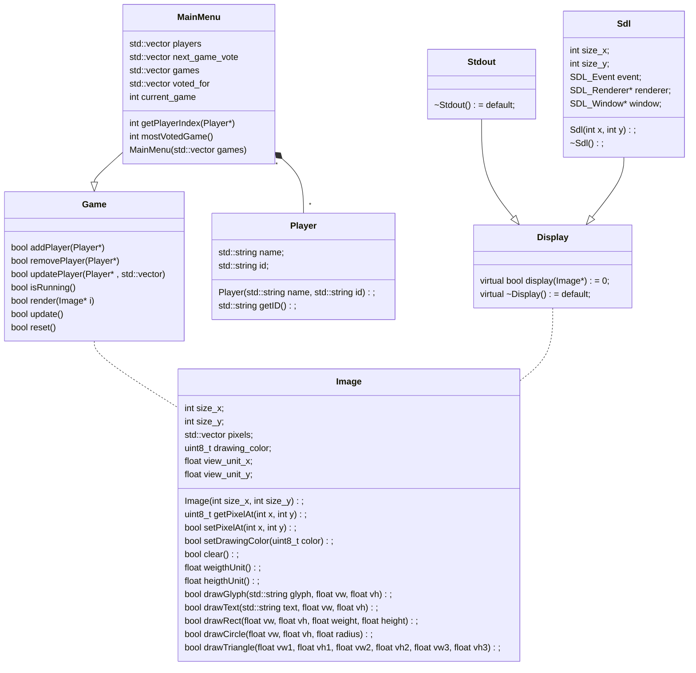

# LED Matrix

The goal of the project is to use a LED display to display things.

Currently we have:

- A base project structure with:
  - Some kind of rendering pipeline
  - A game object
  - A main menu to manage each games
- What we need is:
  - Make an actual game and add it to the main menu
  - Implement font rendering with the lib. [Schrift](https://tomolt.github.io/libschrift/v0.10.2.schrift.3.html) (in include)
  - Implement network managment/player managment with a Network object and [CrowCpp](https://crowcpp.org/master/) (in include)
  - Add display driver for our LED display
  - It would be cool to have a Util folder with convenience functions/Macros like RGB() or HSL() to be able to write RGB/HSL color code in the program and directly convert them to uint8_t (or maybe uint16_t in the future)
- What we can do right now is:
  - Start the Main menu
  - Use the main menu to render something on the Image object
  - Display the image object with a display driver
  

